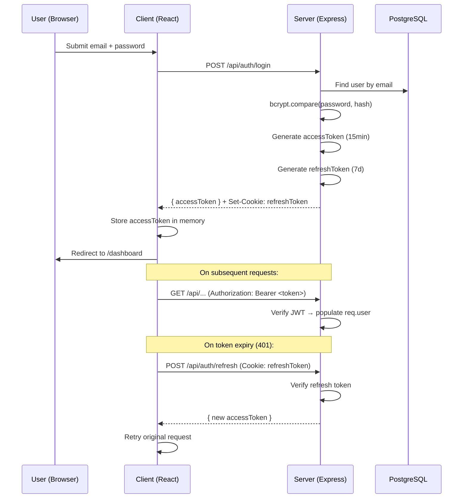
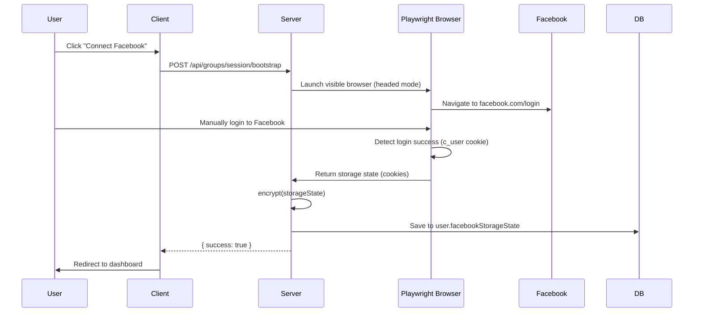
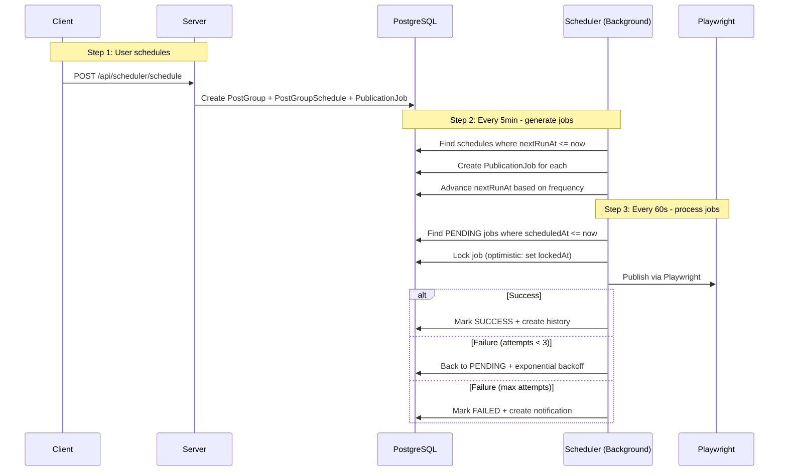
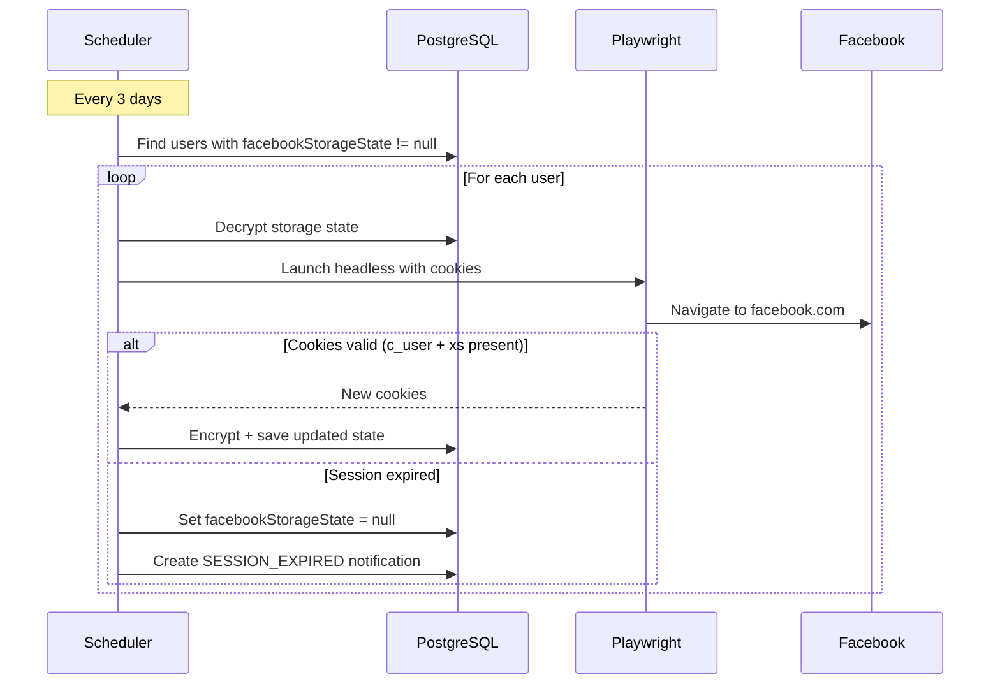

# Data Flow — PostIt

## 1. Authentication Flow



## 2. Facebook Session Bootstrap



## 3. Immediate Publish Flow


## 4. Scheduled Publishing Flow



## 5. Session Keep-Alive Flow



## 6. Multi-Group Publish (Client-Side)

```
User creates post → selects multiple groups → clicks "Publish"
  ↓
Client sends Promise.all([
  publishService.publish(group1Url, text, image, ...),
  publishService.publish(group2Url, text, image, ...),
  publishService.publish(group3Url, text, image, ...),
])
  ↓
Each request → Server → Playwright → Facebook
  ↓
Results displayed per-group (success/failure)
```

## 7. Data Relationships

```
User
 ├── Post[] (content, media, status)
 │    ├── PostMedia[] (images/videos)
 │    └── PostGroup[] (post ↔ group link)
 │         ├── PostGroupSchedule (frequency, nextRunAt)
 │         └── PublicationJob[] (queue entries)
 │              └── PublicationHistory (results)
 ├── Group[] (via UserGroup join)
 ├── Notification[] (alerts)
 ├── ConnectedAccount[] (FB, Instagram)
 └── Subscription (plan, limits)
```
