# Data Flow — Possbo

## 1. Authentication Flow

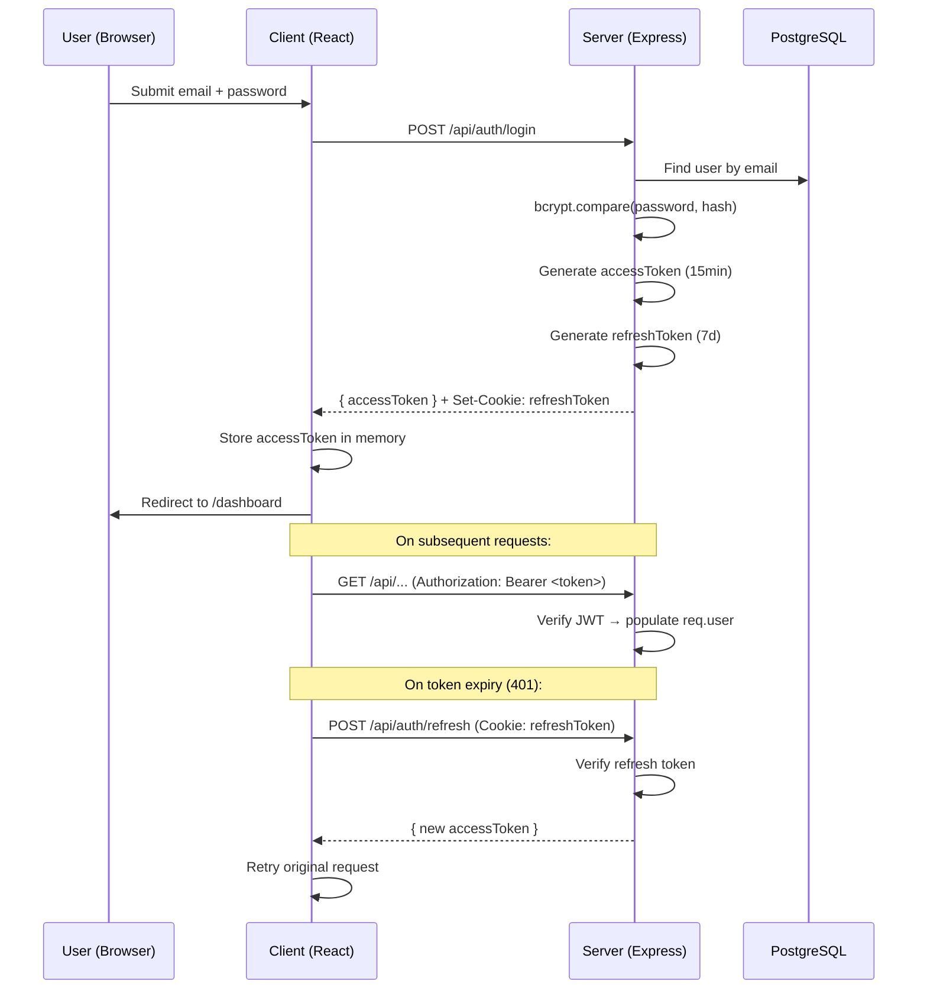

## 2. Registration + Email Verification Flow

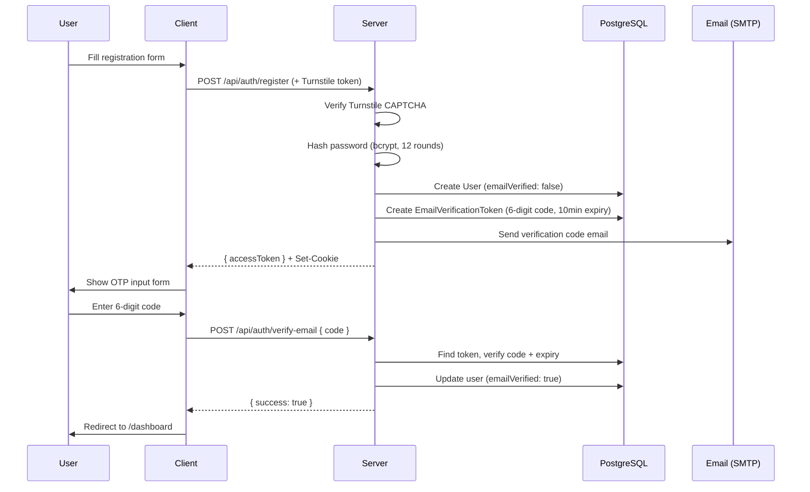

## 3. OAuth Flow

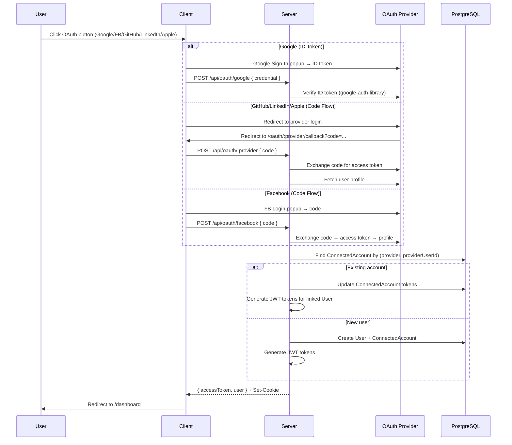

## 4. Facebook Session Bootstrap

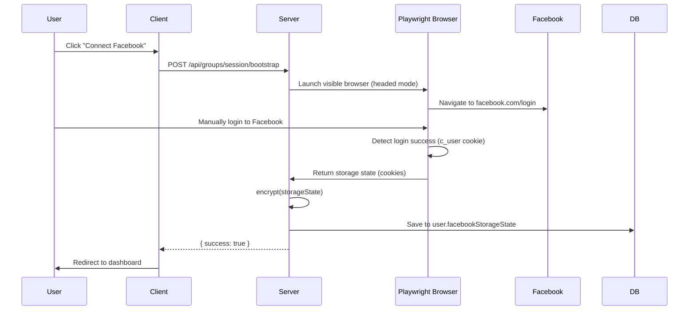

## 5. Immediate Publish Flow

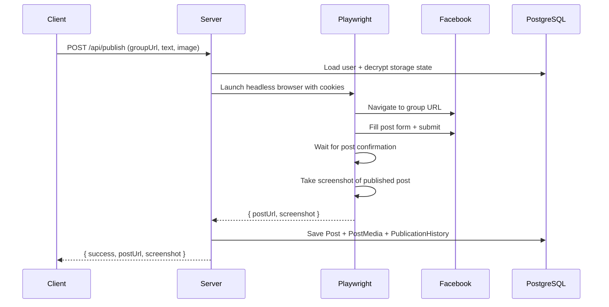

## 6. Scheduled Publishing Flow

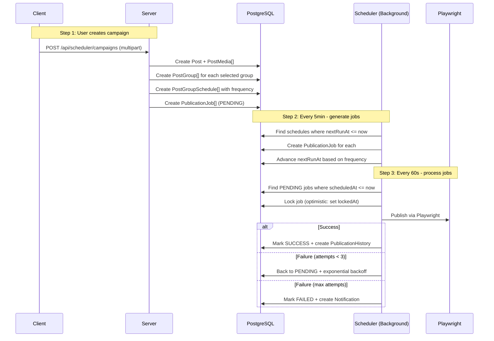

## 7. Instagram Publishing Flow

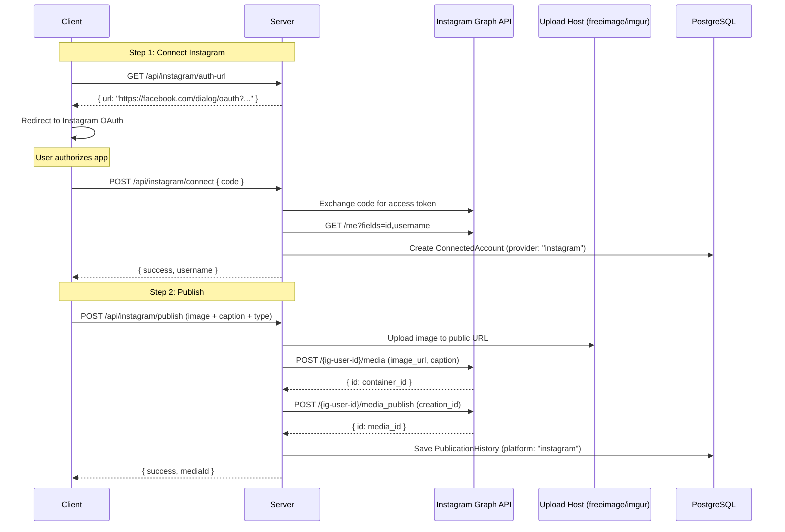

## 8. AI Post Generation Flow

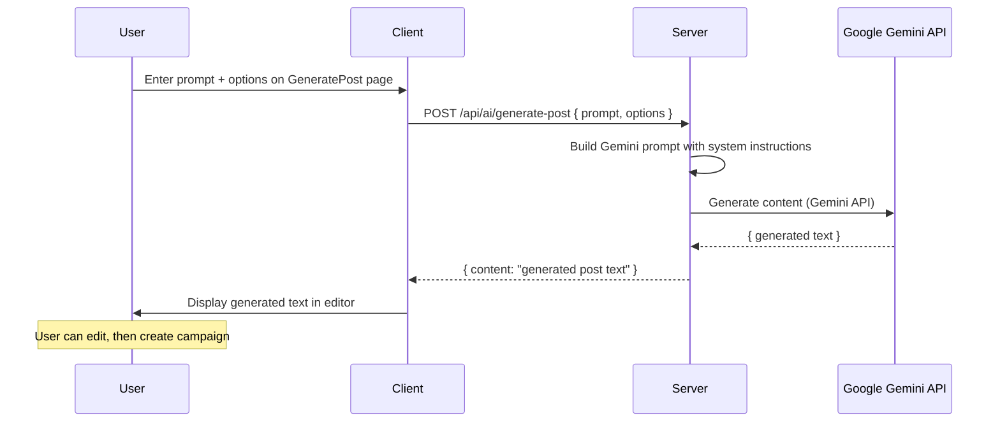

## 9. Session Keep-Alive Flow

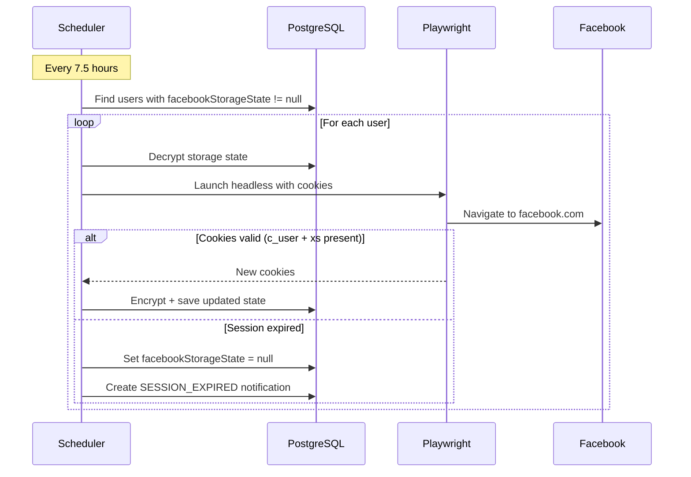

## 10. Metrics Collection Flow

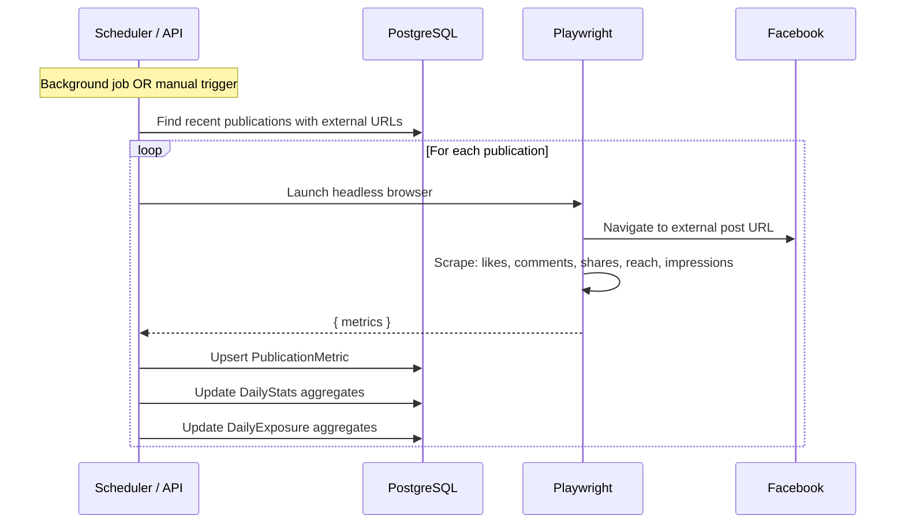

## 11. Multi-Group Publish (Client-Side Parallel)

```
User creates post → selects multiple groups → clicks "Publish"
  ↓
Client dispatches custom event: 'possbo-publish-start'
App.jsx shows global progress banner
  ↓
Client sends Promise.all([
  publishService.publish(group1Url, text, image, ...),
  publishService.publish(group2Url, text, image, ...),
  publishService.publish(group3Url, text, image, ...),
])
  ↓
Each request → Server → Playwright → Facebook
  ↓
Client dispatches: 'possbo-publish-done' with results
Results displayed per-group (success/failure)
Banner shows summary
```

## 12. Password Reset Flow

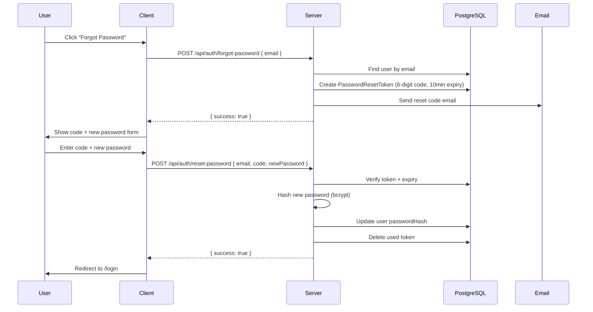

## 13. Data Relationships

```
User
 ├── ConnectedAccount[] (Google, FB, GitHub, LinkedIn, Apple, Instagram)
 ├── Post[] (content, media, status, platform)
 │    ├── PostMedia[] (images/videos)
 │    ├── PostVersion[] (content history)
 │    └── PostGroup[] (post ↔ group link)
 │         ├── PostGroupSchedule (frequency, nextRunAt)
 │         └── PublicationJob[] (queue entries)
 │              └── PublicationHistory (results)
 │                   └── PublicationMetric (engagement data)
 ├── Group[] (via UserGroup join)
 │    └── GroupSyncHistory[]
 ├── PostTemplate[] (saved templates)
 ├── Notification[] (alerts)
 ├── Subscription → Plan
 ├── UsageLimit
 ├── Payment[]
 ├── DailyStats[] (aggregated metrics)
 ├── DailyExposure[] (reach/impressions)
 ├── AuditLog[]
 ├── UserSession[]
 ├── PasswordResetToken
 └── EmailVerificationToken
```
